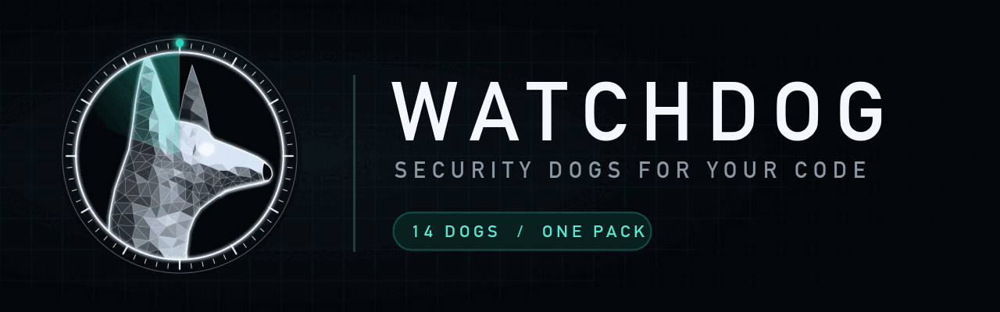
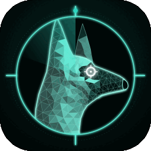
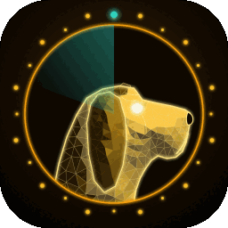
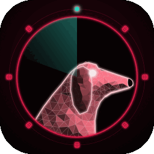
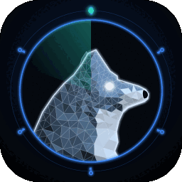
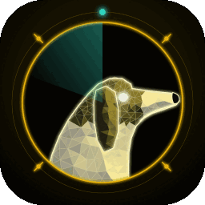
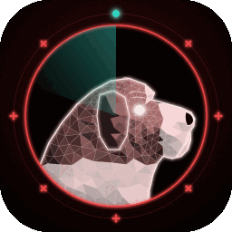

<p align="center"></p>

# Watchdog

**Security review that runs while you build, inside Claude Code.**

You ship features fast. Security review usually comes late, costs a lot, or never happens. Watchdog is a pack of security "dogs": Claude Code plugins that each guard one part of your product. Install it once and the dogs watch every change you make and audit the whole repo on demand.

## What it does for you

- **Catches security bugs while you code, not after launch.** Each dog's lens stays on all session. When you or Claude write a login handler, a SQL query, a Terraform file or an agent tool, the dog flags the risk on the spot: the line, why it's exploitable, and the smallest fix.
- **Gives you a full audit in one command.** `/watchdog-go-vapt code`, `/watchdog-go-api`, `/watchdog-go-cloud`, `/watchdog-go-ai` and the others review the whole repo and return a ranked report: Critical → Low, each with `file:line`, a concrete exploit and a fix.
- **Speaks plain English.** Every finding says what it is, how someone would abuse it, how to fix it, and what happens if you don't. It's useful to a junior dev or a client, not just a security expert.
- **Is honest about its limits.** Every report ends with **Not checked**, so you know what still needs a human.
- **Never leaks what it finds.** Secrets are reported by location and type only; the value is never printed.
- **Uses the tools you already have.** Dogs run installed scanners (semgrep, gitleaks, trivy, checkov, osv-scanner, …) and read the code those scanners can't understand.

## Pick your commands

One install gives you every dog. Run the one command for what you're building, or any single dog on its own:

| You're building… | Dogs | One command | Runs |
|---|---|---|---|
| Web app + API (SaaS) | malinois, bloodhound, doberman, pointer, dachshund, akita, rottweiler | `/watchdog-go-web` | `/watchdog-go-vapt`, `/watchdog-go-api`, `/watchdog-go-auth`, `/watchdog-go-frontend`, `/watchdog-go-database`, `/watchdog-go-secrets`, `/watchdog-go-supply-chain` |
| Mobile app (Flutter / React Native) + backend | shepherd, bloodhound, doberman, dachshund, akita | `/watchdog-go-mobile` | `/watchdog-go-mobile-app`, `/watchdog-go-api`, `/watchdog-go-auth`, `/watchdog-go-database`, `/watchdog-go-secrets` |
| AI product, chatbot or agent | collie, bloodhound, beagle, akita | `/watchdog-go-ai-app` | `/watchdog-go-ai`, `/watchdog-go-api`, `/watchdog-go-privacy`, `/watchdog-go-secrets` |
| Cloud- or infra-heavy system | husky, akita, rottweiler | `/watchdog-go-infra` | `/watchdog-go-cloud`, `/watchdog-go-secrets`, `/watchdog-go-supply-chain` |
| Marketplace with payments | malinois, bloodhound, doberman, dachshund, shepherd, beagle | `/watchdog-go-marketplace` | `/watchdog-go-vapt`, `/watchdog-go-api`, `/watchdog-go-auth`, `/watchdog-go-database`, `/watchdog-go-mobile-app`, `/watchdog-go-privacy` |
| Web3 / DeFi | shiba, pointer, akita | `/watchdog-go-defi` | `/watchdog-go-web3`, `/watchdog-go-frontend`, `/watchdog-go-secrets` |
| Getting ready for a client audit or security questionnaire | pyrenees | `/watchdog-go-compliance` | maps findings to SOC 2, ISO 27001, PCI DSS, ASVS |
| Something already went wrong | saintbernard | `/watchdog-go-incident` | timeline, blast radius, containment |
| Everything at once | all 14 | `/watchdog-go-all` | every dog |

`/watchdog-go-vapt` and `/watchdog-go-secrets` are useful in almost every product.

## Install

```
/plugin marketplace add salahu01/watchdog-lab
/plugin install watchdog@watchdog
```

That one plugin brings the whole pack: every dog and every `/watchdog-go-<area>` command.

Then work as usual. Send a dog out any time:

```
/watchdog-go-all             # every installed dog, one merged report
/watchdog-go-vapt code    # whole-repo security audit (also: web, apk, ipa, report)
/watchdog-go-api       # REST / GraphQL: spec + handlers together
/watchdog-go-ai           # LLM apps and agents
/watchdog-go-cloud            # Terraform, Kubernetes, Docker, CI
```

Every dog follows the same pattern: `/watchdog-go-<area>`. Turn a dog's live lens off with `stop <dog>`.

## How it fits your workflow

1. **While coding:** dogs flag risky code inline as it's written.
2. **Before a PR or release:** run the audit command for your stack and fix the Criticals and Highs.
3. **Before a client handover:** `/watchdog-go-vapt report` (malinois) turns the session's findings into a client-ready report, and pyrenees maps them to SOC 2, ISO 27001, PCI DSS or ASVS.
4. **After an incident:** saintbernard reads the logs and gives you a timeline, blast radius and containment steps.

## The pack

| | Dog | Guards |
|---|-----|--------|
|  | **malinois** | VAPT — vulnerability assessment & pen-test lens: source code, web apps, Android APKs, iOS IPAs, plus the report. Active tests are scope-gated. See [docs/malinois](plugins/watchdog/docs/malinois.md). |
|  | **husky** | Cloud — misconfiguration lens for Terraform, Kubernetes, Dockerfiles and CI pipelines. Static only. See [docs/husky](plugins/watchdog/docs/husky.md). |
|  | **collie** | AI — security lens for LLM apps and agents: prompt injection, agent tools, RAG, MCP, model-output handling. Static only. See [docs/collie](plugins/watchdog/docs/collie.md). |
|  | **bloodhound** | API — security lens for REST and GraphQL: reads the OpenAPI spec and handlers together for BOLA, mass assignment, broken auth, SSRF and shadow routes. Static only. See [docs/bloodhound](plugins/watchdog/docs/bloodhound.md). |
|  | **beagle** | Privacy — Personal data in code, logs, analytics and SDKs; retention; consent; GDPR/DPDP mapping. See [docs/beagle](plugins/watchdog/docs/beagle.md). |
|  | **rottweiler** | Supply chain — Lockfiles, typosquats, install scripts, pinning, SBOM, signed releases, licences. See [docs/rottweiler](plugins/watchdog/docs/rottweiler.md). |
|  | **doberman** | Auth & identity — Login, OAuth/OIDC, sessions, password reset, MFA, JWT, SSO. See [docs/doberman](plugins/watchdog/docs/doberman.md). |
|  | **shepherd** | Mobile deep dive — Android/iOS/Flutter/React Native: pinning, storage, deep links, WebViews, bridges. See [docs/shepherd](plugins/watchdog/docs/shepherd.md). |
|  | **dachshund** | Database — Migrations, row-level security, DB roles, Firebase/Supabase rules, encryption. See [docs/dachshund](plugins/watchdog/docs/dachshund.md). |
|  | **akita** | Secrets lifecycle — Find, rotate and properly store secrets; git history; pre-commit blocking. See [docs/akita](plugins/watchdog/docs/akita.md). |
|  | **pointer** | Frontend — XSS sinks, CSP, postMessage, token storage, third-party scripts. See [docs/pointer](plugins/watchdog/docs/pointer.md). |
|  | **saintbernard** | Incident response — Read logs after a breach: timeline, blast radius, containment steps. See [docs/saintbernard](plugins/watchdog/docs/saintbernard.md). |
|  | **shiba** | Web3 / smart contracts — Solidity/Rust contracts: reentrancy, access control, oracles, upgrades. See [docs/shiba](plugins/watchdog/docs/shiba.md). |
|  | **pyrenees** | Compliance — Map the pack's findings to SOC 2, ISO 27001, PCI DSS, OWASP ASVS. See [docs/pyrenees](plugins/watchdog/docs/pyrenees.md). |

## Does it work?

All 14 dogs have a bench: a small, deliberately vulnerable project with planted issues, decoys and an answer key. Each was run once per model (Haiku 5.5, Sonnet 5.5, Opus 5.5) on a copy of the target without the key.

| Dog | Planted | Haiku | Sonnet | Opus | Criticals missed (any model) |
|---|---|---|---|---|---|
| malinois | 18 | 18 | 18 | 18 | none |
| husky | 17 | 17 | 17 | 17 | none |
| collie | 18 | 18 | 18 | 18 | none |
| bloodhound | 18 | 18 | 18 | 18 | none |
| beagle | 18 | 17 | 18 | 18 | none |
| rottweiler | 17 | 17 | 15 | 17 | Sonnet: dependency confusion |
| doberman | 18 | 18 | 18 | 18 | none |
| shepherd | 18 | 18 | 18 | 18 | none |
| dachshund | 18 | 17 | 17 | 18 | Haiku, Sonnet: one each |
| akita | 18 | 18 | 17 | 17 | none |
| pointer | 18 | 18 | 18 | 18 | none |
| saintbernard | 17 facts | 16 | 16 | 17 | none |
| shiba | 18 | 16 | 17 | 17 | none |
| pyrenees | 18 gaps | 17 | 18 | 16 | none |

Opus was the most precise (fewest decoys flagged); Haiku reported the most extras. Decoys, cross-file traces and redaction results are in each dog's README and `bench/` folder.

These benches are small and written alongside the dogs, so treat the scores as a smoke test, not proof. Real codebases are harder.

## What Watchdog is not

- **Not a replacement for tests, code review or QA.** The dogs look for security issues, not whether your feature works.
- **Not a full pen test.** Most dogs read code; they don't attack your running system. Get a human pen test before launching anything that handles payments or personal data.
- **Not a business-logic oracle.** "Can a user claim the same refund twice?" needs someone who knows how your product should behave.

Use Watchdog to catch the common, high-impact mistakes early and cheaply, and keep the rest of your process.

## ⚖️ Authorized use only

Every dog is for **defensive security and authorized testing**. Static analysis of code and apps you own or are authorized to assess is always fine. **Active testing of a live system** (requests, scanning, fuzzing) (malinois `/watchdog-go-vapt web`) requires written authorization and an in-scope target — the dog refuses otherwise. shepherd runs dynamic tools only on builds you own and put in scope; every other dog is static only. Findings and fixes first; exploit/PoC code only on request and in scope. You are responsible for having permission to test any target.
