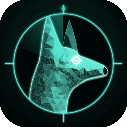
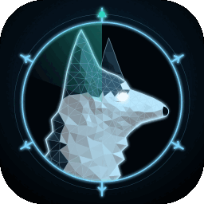
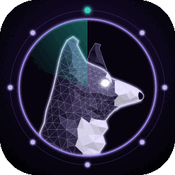
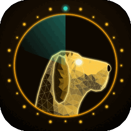
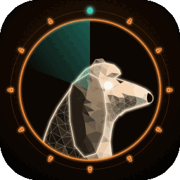
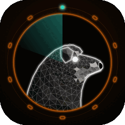
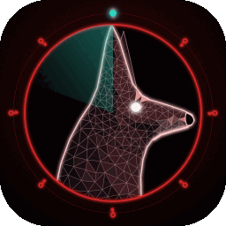
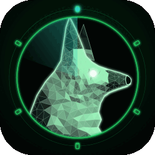
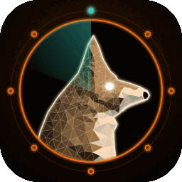
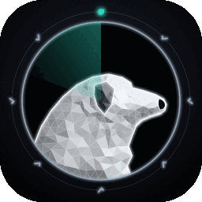

<p align="center"></p>

# Watchdog

**Security review that runs while you build, inside Claude Code.**

You ship features fast. Security review usually comes late, costs a lot, or never happens. Watchdog is a pack of security "dogs": Claude Code plugins that each guard one part of your product. Install the dogs that match what you're building, and they watch every change you make and audit the whole repo on demand.

## What it does for you

- **Catches security bugs while you code, not after launch.** Each dog's lens stays on all session. When you or Claude write a login handler, a SQL query, a Terraform file or an agent tool, the dog flags the risk on the spot: the line, why it's exploitable, and the smallest fix.
- **Gives you a full audit in one command.** `/vapt-code`, `/api-audit`, `/cloud-audit`, `/ai-audit` and the others review the whole repo and return a ranked report: Critical → Low, each with `file:line`, a concrete exploit and a fix.
- **Speaks plain English.** Every finding says what it is, how someone would abuse it, how to fix it, and what happens if you don't. It's useful to a junior dev or a client, not just a security expert.
- **Is honest about its limits.** Every report ends with **Not checked**, so you know what still needs a human.
- **Never leaks what it finds.** Secrets are reported by location and type only; the value is never printed.
- **Uses the tools you already have.** Dogs run installed scanners (semgrep, gitleaks, trivy, checkov, osv-scanner, …) and read the code those scanners can't understand.

## Pick your pack

You don't need all 14. Install the dogs that match what you're building:

| You're building… | Install |
|---|---|
| Web app + API (SaaS) | malinois, bloodhound, doberman, pointer, dachshund, akita, rottweiler |
| Mobile app (Flutter / React Native) + backend | shepherd, bloodhound, doberman, dachshund, akita |
| AI product, chatbot or agent | collie, bloodhound, beagle, akita |
| Cloud- or infra-heavy system | husky, akita, rottweiler |
| Marketplace with payments | malinois, bloodhound, doberman, dachshund, shepherd, beagle |
| Web3 / DeFi | shiba, pointer, akita |
| Getting ready for a client audit or security questionnaire | add **pyrenees** to your pack |
| Something already went wrong | **saintbernard** |

malinois and akita are useful in almost every product.

## Install

```
/plugin marketplace add salahu01/watchdog
/plugin install malinois@watchdog
/plugin install husky@watchdog
/plugin install collie@watchdog
/plugin install bloodhound@watchdog
/plugin install beagle@watchdog
/plugin install rottweiler@watchdog
/plugin install doberman@watchdog
/plugin install shepherd@watchdog
/plugin install dachshund@watchdog
/plugin install akita@watchdog
/plugin install pointer@watchdog
/plugin install saintbernard@watchdog
/plugin install shiba@watchdog
/plugin install pyrenees@watchdog
```

Or install only the dogs from your pack above.

Then work as usual. Run an audit any time:

```
/vapt-code        # whole-repo security audit
/api-audit        # REST / GraphQL: spec + handlers together
/ai-audit         # LLM apps and agents
/cloud-audit      # Terraform, Kubernetes, Docker, CI
```

Turn a dog's lens off with `stop <dog>`.

## How it fits your workflow

1. **While coding:** dogs flag risky code inline as it's written.
2. **Before a PR or release:** run the audit command for your stack and fix the Criticals and Highs.
3. **Before a client handover:** `/vapt-report` (malinois) turns the session's findings into a client-ready report, and pyrenees maps them to SOC 2, ISO 27001, PCI DSS or ASVS.
4. **After an incident:** saintbernard reads the logs and gives you a timeline, blast radius and containment steps.

## The pack

| | Dog | Guards |
|---|-----|--------|
|  | **malinois** | VAPT — vulnerability assessment & pen-test lens: source code, web apps, Android APKs, iOS IPAs, plus the report. Active tests are scope-gated. See [plugins/malinois](plugins/malinois/README.md). |
|  | **husky** | Cloud — misconfiguration lens for Terraform, Kubernetes, Dockerfiles and CI pipelines. Static only. See [plugins/husky](plugins/husky/README.md). |
|  | **collie** | AI — security lens for LLM apps and agents: prompt injection, agent tools, RAG, MCP, model-output handling. Static only. See [plugins/collie](plugins/collie/README.md). |
|  | **bloodhound** | API — security lens for REST and GraphQL: reads the OpenAPI spec and handlers together for BOLA, mass assignment, broken auth, SSRF and shadow routes. Static only. See [plugins/bloodhound](plugins/bloodhound/README.md). |
|  | **beagle** | Privacy — Personal data in code, logs, analytics and SDKs; retention; consent; GDPR/DPDP mapping. See [plugins/beagle](plugins/beagle/README.md). |
|  | **rottweiler** | Supply chain — Lockfiles, typosquats, install scripts, pinning, SBOM, signed releases, licences. See [plugins/rottweiler](plugins/rottweiler/README.md). |
|  | **doberman** | Auth & identity — Login, OAuth/OIDC, sessions, password reset, MFA, JWT, SSO. See [plugins/doberman](plugins/doberman/README.md). |
|  | **shepherd** | Mobile deep dive — Android/iOS/Flutter/React Native: pinning, storage, deep links, WebViews, bridges. See [plugins/shepherd](plugins/shepherd/README.md). |
|  | **dachshund** | Database — Migrations, row-level security, DB roles, Firebase/Supabase rules, encryption. See [plugins/dachshund](plugins/dachshund/README.md). |
|  | **akita** | Secrets lifecycle — Find, rotate and properly store secrets; git history; pre-commit blocking. See [plugins/akita](plugins/akita/README.md). |
|  | **pointer** | Frontend — XSS sinks, CSP, postMessage, token storage, third-party scripts. See [plugins/pointer](plugins/pointer/README.md). |
|  | **saintbernard** | Incident response — Read logs after a breach: timeline, blast radius, containment steps. See [plugins/saintbernard](plugins/saintbernard/README.md). |
|  | **shiba** | Web3 / smart contracts — Solidity/Rust contracts: reentrancy, access control, oracles, upgrades. See [plugins/shiba](plugins/shiba/README.md). |
|  | **pyrenees** | Compliance — Map the pack's findings to SOC 2, ISO 27001, PCI DSS, OWASP ASVS. See [plugins/pyrenees](plugins/pyrenees/README.md). |

## Does it work?

All 14 dogs have a bench: a small, deliberately vulnerable project with planted issues, decoys and an answer key. Each was run once per model (Haiku 5.5, Sonnet 5.5, Opus 5.5) on a copy of the target without the key.

| Dog | Planted | Haiku | Sonnet | Opus | Criticals missed (any model) |
|---|---|---|---|---|---|
| malinois | 18 | 18 | 18 | 18 | none |
| husky | 17 | 17 | 17 | 17 | none |
| collie | 18 | 18 | 18 | 18 | none |
| bloodhound | 18 | 18 | 18 | 18 | none |
| beagle | 18 | 17 | 18 | 18 | none |
| rottweiler | 17 | 17 | 15 | 17 | Sonnet: dependency confusion |
| doberman | 18 | 18 | 18 | 18 | none |
| shepherd | 18 | 18 | 18 | 18 | none |
| dachshund | 18 | 17 | 17 | 18 | Haiku, Sonnet: one each |
| akita | 18 | 18 | 17 | 17 | none |
| pointer | 18 | 18 | 18 | 18 | none |
| saintbernard | 17 facts | 16 | 16 | 17 | none |
| shiba | 18 | 16 | 17 | 17 | none |
| pyrenees | 18 gaps | 17 | 18 | 16 | none |

Opus was the most precise (fewest decoys flagged); Haiku reported the most extras. Decoys, cross-file traces and redaction results are in each dog's README and `bench/` folder.

These benches are small and written alongside the dogs, so treat the scores as a smoke test, not proof. Real codebases are harder.

## What Watchdog is not

- **Not a replacement for tests, code review or QA.** The dogs look for security issues, not whether your feature works.
- **Not a full pen test.** Most dogs read code; they don't attack your running system. Get a human pen test before launching anything that handles payments or personal data.
- **Not a business-logic oracle.** "Can a user claim the same refund twice?" needs someone who knows how your product should behave.

Use Watchdog to catch the common, high-impact mistakes early and cheaply, and keep the rest of your process.

## ⚖️ Authorized use only

Every dog is for **defensive security and authorized testing**. Static analysis of code and apps you own or are authorized to assess is always fine. **Active testing of a live system** (requests, scanning, fuzzing) (malinois `/vapt-web`) requires written authorization and an in-scope target — the dog refuses otherwise. shepherd runs dynamic tools only on builds you own and put in scope; every other dog is static only. Findings and fixes first; exploit/PoC code only on request and in scope. You are responsible for having permission to test any target.
