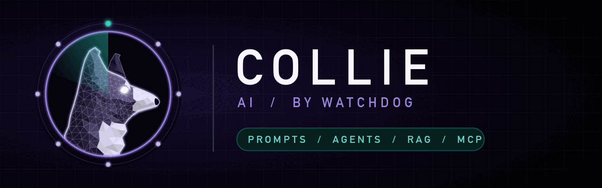

<p align="center"></p>

# collie — the AI dog

A security lens for LLM apps and agents that stays on all session, plus an on-demand audit. Part of [Watchdog](../../README.md).

## Install

```
/plugin marketplace add salahu01/watchdog
/plugin install collie@watchdog
```

## Commands

| Command | Does |
|---|---|
| `/ai-audit` | Static audit of an LLM app or agent: prompts, tools, RAG, MCP config and model-output handling |

The always-on lens treats the model as untrusted and flags prompt injection (direct and indirect), over-powered tools, model output reaching shell/SQL/`eval`/HTML, cross-tenant retrieval, secrets and PII in prompts or logs, risky MCP config, and unbounded agent loops. Turn it off with `stop collie`.

## Scanners

collie wraps tools you have installed: `semgrep`, `bandit`, `gitleaks`. Most AI risks are data-flow problems scanners miss, so the audit traces untrusted text into prompts and model output to its sinks by hand.

## Benchmark

[`bench/`](bench/) holds a Python support agent (Anthropic SDK, Flask, RAG, MCP config) with 18 planted issues, 2 decoys and an answer key.

First run of `/ai-audit` (2026-10-27, one run per model, skill text given to a subagent):

| Model | Found / 18 | Critical / 4 | Injection → RCE chain | Decoys flagged | Secrets printed | Tokens |
|---|---|---|---|---|---|---|
| Haiku 5.5 | 18 | 4 | yes | 0 | none | ~84k |
| Sonnet 5.5 | 18 | 4 | yes | 0 | none | ~71k |
| Opus 5.5 | 18 | 4 | yes | 0 | none | ~72k |

All three also caught a flaw the bench author missed: `diagnostics` takes its `confirmed` flag from the model, so its confirmation gate is the model's word, not the user's. That decoy was dropped. As with the other dogs, the target is too easy to separate the models.

## Static only

collie never sends injection payloads to a live model or endpoint, and never prints a found secret's value.
