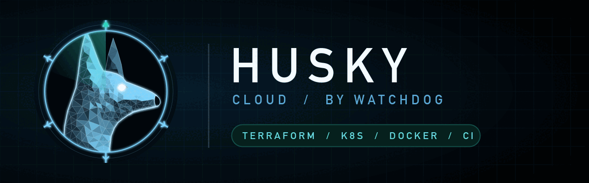

<p align="center"></p>

# husky — the cloud dog

A misconfiguration lens for infrastructure-as-code that stays on all session, plus an on-demand audit. Part of [Watchdog](../../README.md).

## Install

```
/plugin marketplace add salahu01/watchdog
/plugin install husky@watchdog
```

## Commands

| Command | Does |
|---|---|
| `/cloud-audit` | Static audit of Terraform, CloudFormation, Kubernetes, Helm, Dockerfiles and CI pipelines |

The always-on lens flags public exposure, wildcard IAM, secrets in config, privileged containers, missing encryption/logging and CI supply-chain risks as you work. Turn it off with `stop husky`.

## Scanners

husky wraps tools you have installed: `checkov`, `trivy config`, `tfsec`, `kube-score`, `hadolint`, `actionlint`, `gitleaks`. Missing ones are named in the report's **Not checked** section.

## Benchmark

[`bench/`](bench/) holds an insecure Terraform + Kubernetes + Dockerfile + GitHub Actions setup (17 planted misconfigs, 3 decoys) and an answer key. First run of `/cloud-audit` (2026-10-27, one run per model, skill text given to a subagent):

| Model | Found / 17 | Critical / 4 | Cross-file SSH | Decoys flagged | Secrets redacted | Tokens |
|---|---|---|---|---|---|---|
| Haiku 5.5 | 17 | 4 | yes | 1 (tfstate bucket) | no — printed DB password | ~79k |
| Sonnet 5.5 | 17 | 4 | yes | 1 (tfstate bucket, Low) | yes | ~71k |
| Opus 5.5 | 17 | 4 | yes | 0 | yes | ~71k |

Only gitleaks was installed and it missed the hardcoded AWS key; every model caught it by reading. Haiku broke the redaction rule (printed the DB password). After tightening the rule to "never print a value, even weak defaults", a Haiku rerun leaked nothing.

## Static only

husky never runs `terraform apply`, `kubectl apply` or any call that changes cloud state. Read-only cloud queries only against accounts you say you own. Found secrets are redacted.
