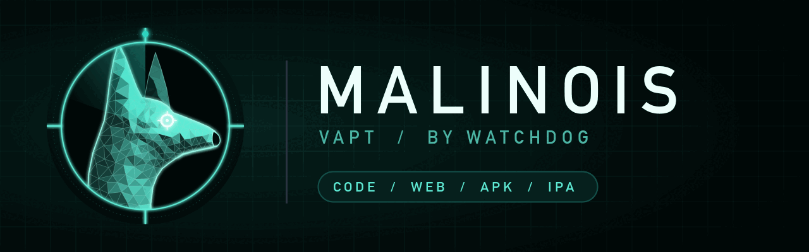

<p align="center"></p>

# malinois — the VAPT dog

A security-review lens that stays on all session, plus on-demand audits. Part of [Watchdog](../../README.md).

## Install

```
/plugin marketplace add salahu01/watchdog
/plugin install malinois@watchdog
```

## Commands

| Command | Does |
|---|---|
| `/vapt-code` | Static audit of a source repo (SAST + dependency CVEs + secrets) |
| `/vapt-web` | Assessment of a running web app (scope-gated) |
| `/vapt-apk` | Static Android APK audit (OWASP MASVS) |
| `/vapt-ipa` | Static iOS IPA audit (OWASP MASVS) |
| `/vapt-report` | Merge the session's findings into one ranked report |

The always-on lens flags injection, broken authz/authn, secrets, SSRF, path traversal, unsafe deserialization, weak crypto and insecure defaults as you work. Turn it off with `stop malinois`.

## Config

Set in `/plugin`:
- `authScope` — targets you have written permission to actively test. Active testing outside it is refused.
- `reportDir` — where `/vapt-report` writes (default `./malinois-reports`).

## Scanners

malinois wraps tools you have installed instead of reinventing them: `npm audit`, `pip-audit`, `osv-scanner`, `govulncheck`, `bundler-audit`, `gitleaks`, `trufflehog`. Missing ones are named in the report's **Not checked** section.

## Benchmark

[`bench/`](bench/) holds a deliberately vulnerable Express API (18 planted vulns, 2 decoys) and an answer key. First run of `/vapt-code` (2026-10-27, one run per model, skill text given to a subagent):

| Model | Found / 18 | Critical / 4 | False positives | Secret redacted | Tokens |
|---|---|---|---|---|---|
| Haiku 5.5 | 18 | 4 | 0 | yes | ~105k |
| Sonnet 5.5 | 18 | 4 | 0 | yes | ~71k |
| Opus 5.5 | 18 | 4 | 0 | yes | ~71k |
| Fable 5.1 | not run | | | | |

All models scored full marks, so this target is too easy to separate them. A harder target (cross-file flows, logic flaws) is next.

## Authorized use only

For **defensive security and authorized testing**. Static analysis of code and apps you own or are authorized to assess is always fine. **Active testing of a live system** (requests, scanning, fuzzing) requires written authorization and an in-scope target — the dog refuses otherwise. Findings and fixes first; exploit/PoC code only on request and in scope. You are responsible for having permission to test any target.
