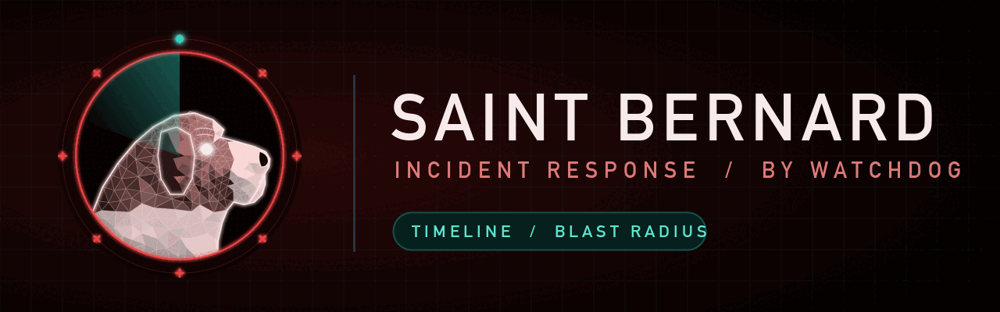

# saintbernard — the incident response dog

The incident-response dog. Comes to the rescue after something went wrong: reads logs, builds a timeline, finds blast radius and writes containment steps. Part of [Watchdog](../../README.md).

> Status: **0.1.0, new.** No benchmark or logo yet.

## Install

```
/plugin marketplace add salahu01/watchdog
/plugin install saintbernard@watchdog
```

## Commands

| Command | Does |
|---|---|
| `/incident-triage` | Read logs after a breach: timeline, blast radius, containment steps |

The always-on lens watches incidents, breaches, suspicious logs, alerts, compromised keys, post-mortems. Turn it off with `stop saintbernard`.

## What it checks

- **Scope the evidence** — which logs exist (app, auth, cloud audit, CDN, DB); time window; preserve originals read-only.
- **Timeline** — first sign, initial access, actions taken, last activity; with log line references.
- **Indicators** — IPs, user agents, accounts, keys, files and endpoints involved.
- **Blast radius** — data, accounts, systems and secrets the attacker could reach from what was used.
- **Containment** — keys to rotate, sessions to revoke, accounts to lock, rules to add; ordered by urgency.
- **Root cause and follow-up** — the weakness exploited and which Watchdog dog guards it next time.

## Tools it wraps

`jq`, `rg`, `chainsaw`/`sigma` rules, cloud audit-log CLIs (read-only). Missing ones are named in the report's **Not checked** section.

## Rules

Static review only. Never change live systems or send traffic to targets outside the user's written scope. Never print a secret's value — not keys, tokens or passwords, even weak defaults. Give file:line and the secret type only.
