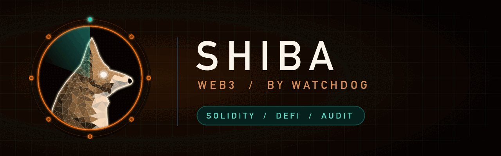

# shiba — the web3 dog

The Web3 dog. Audits smart contracts in Solidity and Rust: reentrancy, access control, oracle manipulation, arithmetic and upgrade proxies. Part of [Watchdog](../../README.md).

> Status: **0.1.0.** Benchmarked 2026-10-28, see below.

## Install

```
/plugin marketplace add salahu01/watchdog
/plugin install shiba@watchdog
```

## Commands

| Command | Does |
|---|---|
| `/contract-audit` | Solidity/Rust contracts: reentrancy, access control, oracles, upgrades |

The always-on lens watches Solidity, Vyper, Rust (Anchor/Solana), Foundry, Hardhat, DeFi, NFTs. Turn it off with `stop shiba`.

## What it checks

- **Reentrancy** — external calls before state updates, cross-function and read-only reentrancy.
- **Access control** — missing `onlyOwner`/role checks, unprotected initialisers, `tx.origin` auth.
- **Oracles and pricing** — spot prices from a single pool, flash-loan manipulable values, stale feeds.
- **Arithmetic and precision** — rounding direction, unchecked blocks, decimals mismatch.
- **Upgrades** — storage collisions, uninitialised implementations, unrestricted upgrade functions.
- **Token handling** — fee-on-transfer/rebasing tokens, unchecked return values, approval races.
- **Denial of service** — unbounded loops, push payments that can revert.

## Tools it wraps

`slither`, `aderyn`, `mythril`, `forge test`/fuzzing on local forks only. Missing ones are named in the report's **Not checked** section.

## Benchmark

[`bench/`](bench/) holds a Foundry DeFi project (vault, oracle, proxy, token, deploy script): 18 planted issues, 3 decoys and an answer key.

First run of `/contract-audit` (2026-10-28, one run per model, skill text given to a subagent against a copy of `target/` without the answer key):

| Model | Found / 18 | Critical / 5 | Cross-contract (W03 + W05) | Decoys flagged | Secrets printed |
|---|---|---|---|---|---|
| Haiku 5.5 | 16 | 5 | yes | 2 | none |
| Sonnet 5.5 | 17 | 5 | yes | 1–2 | none |
| Opus 5.5 | 17 | 5 | yes | 0–1 | none |

Every critical was found by every model. Sonnet and Opus missed the uninitialised implementation in the deploy script (W17); Haiku produced the most low-value extras (29 findings).

## Rules

Static review only. Never change live systems or send traffic to targets outside the user's written scope. Never print a secret's value — not keys, tokens or passwords, even weak defaults. Give file:line and the secret type only.
