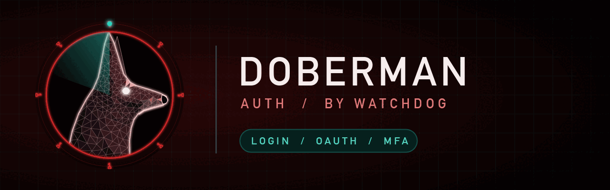

# doberman — the auth dog

The auth dog. Guards the front door: login, OAuth/OIDC, sessions, password reset, MFA, JWTs and SSO. Part of [Watchdog](../../README.md).

> Status: **0.1.0.** Benchmarked 2026-10-28, see below.

## Install

```
/plugin marketplace add salahu01/watchdog
/plugin install watchdog@watchdog
```

## Commands

| Command | Does |
|---|---|
| `/go-doberman` | Login, OAuth/OIDC, sessions, password reset, MFA, JWT, SSO |

The always-on lens watches login, signup, OAuth, OIDC, SAML, sessions, cookies, JWT, password reset, MFA. Turn it off with `stop doberman`.

## What it checks

- **Credentials** — weak hashing (MD5/SHA1/unsalted), no rate limit or lockout, user enumeration via messages or timing.
- **Sessions** — cookies without Secure/HttpOnly/SameSite, no rotation on login, no server-side logout, long-lived tokens.
- **JWT** — decode without verify, `alg: none`/HS-RS confusion, no expiry, secrets in code.
- **OAuth/OIDC** — missing `state`/PKCE, open redirect_uri, token in URL fragment logs, id_token not validated (iss/aud/nonce).
- **Password reset** — guessable or non-expiring tokens, token in response, no invalidation after use.
- **MFA** — bypassable step, recovery codes in plaintext, MFA not enforced on sensitive actions.
- **Account linking and SSO** — email-based auto-linking, unverified emails trusted.

## Tools it wraps

`semgrep` (auth rulesets), `gitleaks detect`. Missing ones are named in the report's **Not checked** section.

## Benchmark

[`bench/`](../bench/doberman/) holds an Express auth service (login, MFA, OAuth, reset, SAML SSO, JWT): 18 planted issues, 3 decoys and an answer key.

First run of `/go-doberman` (2026-10-28, one run per model, skill text given to a subagent against a copy of `target/` without the answer key):

| Model | Found / 18 | Critical / 4 | MFA bypass traced | Decoys flagged | Secrets printed |
|---|---|---|---|---|---|
| Haiku 5.5 | 18 | 4 | yes | 2 | none |
| Sonnet 5.5 | 18 | 4 | yes | 2 | none |
| Opus 5.5 | 18 | 4 | yes | 0 | none |

Full recall for all three; only Opus cleared every decoy. Haiku rated the SAML auto-link critical as High.

## Rules

Static review only. Never change live systems or send traffic to targets outside the user's written scope. Never print a secret's value — not keys, tokens or passwords, even weak defaults. Give file:line and the secret type only.
