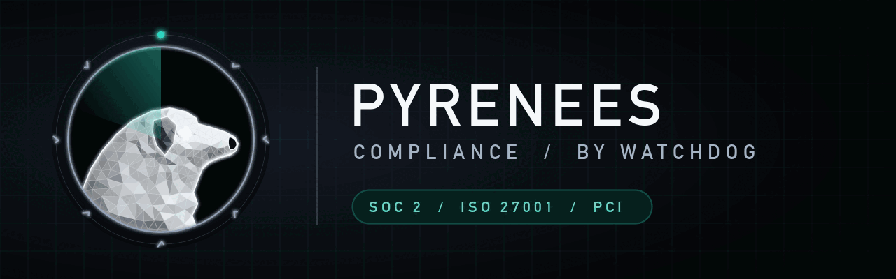

# pyrenees — the compliance dog

The compliance dog. Maps findings from every Watchdog dog to SOC 2, ISO 27001, PCI DSS and OWASP ASVS, and lists the evidence an auditor will ask for. Part of [Watchdog](../../README.md).

> Status: **0.1.0.** Benchmarked 2026-10-28, see below.

## Install

```
/plugin marketplace add salahu01/watchdog
/plugin install watchdog@watchdog
```

## Commands

| Command | Does |
|---|---|
| `/watchdog-go-compliance` | Map the pack's findings to SOC 2, ISO 27001, PCI DSS, OWASP ASVS |

The always-on lens watches SOC 2, ISO 27001, PCI DSS, ASVS, audits, controls, evidence, security questionnaires. Turn it off with `stop pyrenees`.

## What it checks

- **Collect findings** — read reports from other Watchdog dogs in the session or the report directory.
- **Map to controls** — each finding to the framework controls it breaks (e.g. SOC 2 CC6.1, ISO 27001 A.8.24, PCI DSS 3.5, ASVS V2).
- **Gaps** — controls with no evidence in the repo (logging, access reviews, backups, incident process).
- **Evidence list** — what to show an auditor: configs, policies, screenshots, tickets, with file paths.
- **Questionnaires** — draft answers from the code and config, marked where a human must confirm.
- **Honesty** — never claim compliance; state coverage and what is unverified.

## Tools it wraps

reads other dogs' reports; no scanners. Missing ones are named in the report's **Not checked** section.

## Benchmark

[`bench/`](../bench/pyrenees/) holds a SaaS snapshot plus `findings.md` from other dogs: 18 planted compliance gaps, 3 decoys and an answer key.

First run of `/watchdog-go-compliance` (2026-10-28, one run per model, skill text given to a subagent against a copy of `target/` without the answer key):

| Model | Gaps / 18 | Critical / 4 | Cross-file (C02, C03) | Control IDs right | Decoys flagged |
|---|---|---|---|---|---|
| Haiku 5.5 | 17 | 4 | yes | 17 / 17 | 1 |
| Sonnet 5.5 | 18 | 4 | yes | 16 / 18 | 0 |
| Opus 5.5 | 16 | 4 | yes | 16 / 16 | 0 |

Control IDs in the answer key are from memory, not checked against the framework texts; treat that column as indicative.

## Rules

Static review only. Never change live systems or send traffic to targets outside the user's written scope. Never print a secret's value — not keys, tokens or passwords, even weak defaults. Give file:line and the secret type only.
