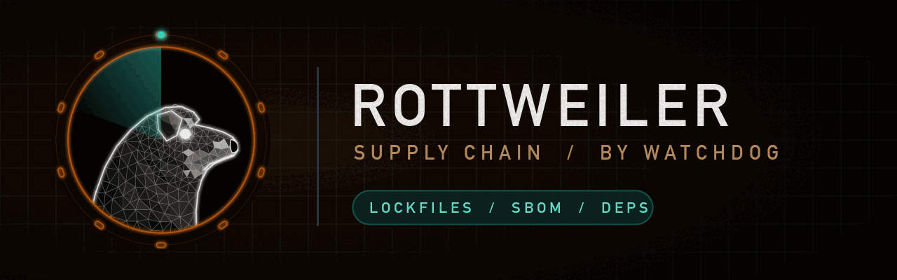

# rottweiler — the supply chain dog

The supply-chain dog. Guards what you pull in: lockfiles, package names, install scripts, pinning, SBOMs, release signing and licences. Part of [Watchdog](../../README.md).

> Status: **0.1.0.** Benchmarked 2026-10-28, see below.

## Install

```
/plugin marketplace add salahu01/watchdog
/plugin install watchdog@watchdog
```

## Commands

| Command | Does |
|---|---|
| `/go-rottweiler` | Lockfiles, typosquats, install scripts, pinning, SBOM, signed releases, licences |

The always-on lens watches dependencies, lockfiles, package.json, requirements, go.mod, Dockerfile base images, release pipelines. Turn it off with `stop rottweiler`.

## What it checks

- **Known vulnerabilities** — dependencies with CVEs, reachable or not; fixed versions.
- **Lockfile integrity** — missing or out-of-sync lockfiles, registry URLs changed, integrity hashes absent.
- **Typosquats and confusion** — look-alike names, internal package names resolvable on public registries.
- **Install-time code** — `postinstall`/`setup.py` scripts, native builds, `curl | sh`.
- **Pinning** — ranges, `latest`, unpinned base images and CI actions.
- **Provenance** — no SBOM, unsigned releases, no build attestation.
- **Licences** — copyleft or unknown licences in a proprietary product.

## Tools it wraps

`osv-scanner -r .`, `syft`, `grype`, `npm audit`/`pip-audit`, `socket` CLI. Missing ones are named in the report's **Not checked** section.

## Benchmark

[`bench/`](../bench/rottweiler/) holds a Node + Python service with lockfiles, `.npmrc`, Dockerfile and a release workflow: 17 planted supply-chain issues, 3 decoys and an answer key.

First run of `/go-rottweiler` (2026-10-28, one run per model, skill text given to a subagent against a copy of `target/` without the answer key):

| Model | Found / 17 | Critical / 4 | Cross-file (.npmrc + lockfile) | Decoys flagged | Secrets printed |
|---|---|---|---|---|---|
| Haiku 5.5 | 17 | 4 | partial | 2 | none |
| Sonnet 5.5 | 15 | 3 | no | 2 | none |
| Opus 5.5 | 17 | 4 | yes | 2 | none |

First bench to separate the models: Sonnet missed the dependency-confusion critical (R02); only Opus traced it to the missing scope in `.npmrc`. All three flagged the esbuild install script and the placeholder base-image digest.

## Rules

Static review only. Never change live systems or send traffic to targets outside the user's written scope. Never print a secret's value — not keys, tokens or passwords, even weak defaults. Give file:line and the secret type only.
